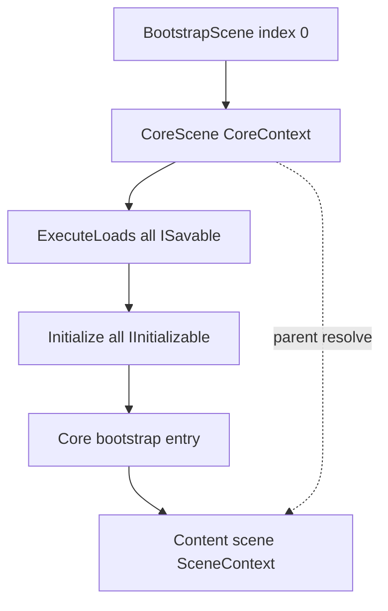

# AI Agent Guide — comet_cleave (Unity)

**Framework:** [docs/ARCHITECTURE.md](docs/ARCHITECTURE.md) — Engine + Core (DI, scenes, save orchestration).  
**Core systems:** [docs/SYSTEMS.md](docs/SYSTEMS.md) — lifecycle, Config / Runtime / Save.  
**Code style:** [docs/CODE_STYLE.md](docs/CODE_STYLE.md) — naming, formatting, Unity conventions.

---

## Rules (short)

```csharp
// Savable — Core installer (session progress) or scene installer (scene-scoped prefs)
container.BindInstance(_myConfig);
container.Bind<MySavableSystem>();

// Load → then Initialize (bind order between systems)
void ISavable.Load() { /* SaveLoadStorage + build runtime */ }
public void Initialize() { /* subscriptions */ }

// Content scene — inject Core, never reload
public ContentEntryPoint(MySavableSystem system) { }

[Inject] public void Inject(GameSettings s) { }

OnSaveRequired?.Invoke();

// Forbidden from gameplay/UI code
SaveLoadService.ExecuteLoads();
SaveLoadService.Dispose();
```

1. **Core savables** load once at `CoreContext` init; **scene savables** load scoped when `SceneContext` opens (`ExecuteLoads(savables)`).
2. **`Load()`** then **`Initialize()`** — see [SYSTEMS.md](docs/SYSTEMS.md#lifecycle).
3. Resolve Core via **constructor** / **`[Inject]`** — no `Container.Get<T>()`.
4. **Plain C#** = constructor; **scene `MonoBehaviour`** = `[Inject]` or `BindInstance`.
5. **`Bind` order = `Initialize()` order** on `CoreContext`.
6. **Play Mode / build index 0** is **BootstrapScene**. `BootstrapEntryPoint` only loads **CoreScene**. **CoreScene** is the runtime root (`CoreContext`, DI, `ReloadContext`). Starting Play on CoreScene still works; this project starts from Bootstrap. Do not rename CoreScene to Bootstrap.

---

## Project map

| Path | Role |
|------|------|
| `Assets/- Game -/Engine/` | Framework: container, contexts, `SaveLoadService`, scene loading |
| `Assets/- Game -/Scripts/Core/` | Persistent systems, configs, savables |
| Other under `Scripts/` | Product-specific (Gameplay) |
| `Assets/- Scenes -/GameplayScene.unity` | First content scene after Core |
| `Assets/- Scenes -/BootstrapScene.unity` | **Play Mode / build index 0** |
| `Assets/- Scenes -/CoreScene.unity` | Runtime root (`CoreContext`) |

---

## Where to put new code

| Task | Doc |
|------|-----|
| New Core system (config, runtime, save) | [SYSTEMS.md](docs/SYSTEMS.md) |
| Framework (installers, DI, scenes) | [ARCHITECTURE.md](docs/ARCHITECTURE.md) |
| Core savable skeleton | [ARCHITECTURE.md — minimal savable](docs/ARCHITECTURE.md#minimal-savable-copy-paste-skeleton) |
| C# style (naming, LINQ, braces, comments) | [CODE_STYLE.md](docs/CODE_STYLE.md) |

---

## Quick lifecycle



---

## Copy-paste starting points

| Task | File / doc |
|------|------------|
| System pattern | [docs/SYSTEMS.md](docs/SYSTEMS.md) |
| Container pipeline | `Assets/- Game -/Engine/Container/GameContainer.cs` |
| Root context | `Assets/- Game -/Engine/Context/CoreContext.cs` |
| Storage I/O | `Assets/- Game -/Scripts/Core/SaveLoadІStorage/ProgressSaveStorage.cs`, `SettingsSaveStorage.cs` |

---

## Cursor rules

- `Assets/- Game -/**` → `.cursor/rules/architecture.mdc`, `.cursor/rules/code-style.mdc`
- Core systems → `.cursor/rules/systems.mdc` (when editing `Scripts/Core/**`)

---

## Behavior

- Read a file before editing it. Do not invent its contents.
- Change only what was asked, and apply that edit immediately.
- If the architecture is unclear, read the existing project guide before changing it: [docs/ARCHITECTURE.md](docs/ARCHITECTURE.md), [docs/SYSTEMS.md](docs/SYSTEMS.md), [docs/CODE_STYLE.md](docs/CODE_STYLE.md).
