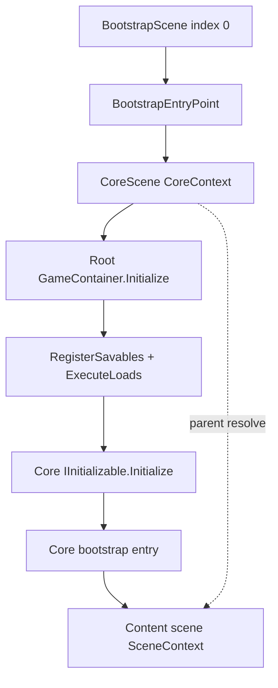

# Game Architecture — comet_cleave

This document describes the **shared game framework**: dependency injection, lifecycle, scenes, and save/load. It applies to code under `Assets/- Game -/Engine/` and persistent systems under `Assets/- Game -/Scripts/Core/`.

**Out of scope (product-specific, may differ per project):**

- Meta systems, configs, and installers under `Scripts/Core/...` beyond infrastructure patterns
- Content scenes (gameplay, etc.) and their installers / UI
- Pre-Core product work beyond the thin Bootstrap door (authentication, remote config, etc.)

**Quick entry for agents:** [AGENTS.md](../AGENTS.md)  
**Core systems (Load, Config, Runtime, Save):** [SYSTEMS.md](SYSTEMS.md)  
**Code style:** [CODE_STYLE.md](CODE_STYLE.md)

---

## Table of contents

1. [Overview](#overview)
2. [Boot and scene flow](#boot-and-scene-flow)
3. [Contexts and containers](#contexts-and-containers)
4. [GameContainer.Initialize pipeline](#gamecontainerinitialize-pipeline)
5. [Installers](#installers)
6. [Dependency injection](#dependency-injection)
7. [Scene object discovery](#scene-object-discovery)
8. [Interfaces matrix](#interfaces-matrix)
9. [Save and load](#save-and-load)
10. [Accessing Core from content scenes](#accessing-core-from-content-scenes)
11. [Dispose and session shutdown](#dispose-and-session-shutdown)
12. [Anti-patterns](#anti-patterns)
13. [Recipes](#recipes)
14. [File reference](#file-reference)

---

## Overview

| Piece | Role |
|-------|------|
| **`GameContainer`** | DI: bind, create, inject, initialize, dispose |
| **`CoreContext`** | Root container for the session (`DontDestroyOnLoad`) |
| **`SceneContext`** | Child container per **content scene** |
| **`SaveLoadService`** | Savable registry; `ExecuteLoads` / `ExecuteSaves` |
| **`ProgressSaveStorage` / `SettingsSaveStorage`** | JSON files (Core infrastructure) |
| **`SceneLoadService`** | Scene load / reload / restore |
| **`GameTicker`** | `ITickable.Tick()` from `CoreContext.Update` |

Reference: `Assets/- Game -/Engine/Container/GameContainer.cs`

---

## Boot and scene flow

### Project entry: BootstrapScene

In this template, **BootstrapScene** is build index 0 and the scene to enter Play Mode from. It is the door, not a container.

`Assets/- Game -/Scripts/Bootstrap/BootstrapEntryPoint.cs` only shuts down a leftover Core and loads Core:

```csharp
if (CoreContext.IsReady)
{
    CoreContext.Shutdown();
}

SceneLoadService.LoadCoreScene();
```

The camera and loading view stay on that scene: nothing else can draw a frame before Core exists.

### Runtime root: CoreScene

**CoreScene** is the session root. `ReloadContext` and `IsCoreScene()` use the name `CoreScene`. Do not rename it to Bootstrap. A Play from a content scene reloads Core, not the splash, and the door must stay separate from the container.

Starting Play directly on **CoreScene** still works. It is an Engine path, not how this project starts.

```csharp
// After CoreContext.Awake finishes:
CoreContext.IsReady == true
CoreContext.Container != null
```

Typical sequence:

1. `BootstrapEntryPoint` loads **CoreScene** (skipped when Play starts on Core or on a content scene).
2. Root `GameContainer.Initialize` → savables `Load()` via `ExecuteLoads()`.
3. Core `IInitializable.Initialize()` in bind order.
4. **Core bootstrap entry** loads **GameplayScene**, or restores the content scene Play was started from.

The Engine does not require a pre-Core scene. This template keeps a thin one so the start scene is obvious.

Minimal bootstrap entry (pattern only — name/type is project-specific):

```csharp
public class CoreBootstrapEntry : IInitializable
{
    public void Initialize()
    {
        if (SceneLoadService.ShouldRestoreScene)
        {
            SceneLoadService.RestoreScene();
            return;
        }

        SceneLoadService.LoadGameplayScene();
    }
}
```

Register in a **Core** installer:

```csharp
container.Bind<CoreBootstrapEntry>(); // usually after systems it does not depend on
```

Reference (this repo’s implementation of the same pattern):  
`Assets/- Game -/Scripts/Core/EntryPoint/GameplayTransitionPoint.cs`

### Content scene without Core (reload path)

```csharp
// SceneContext.Awake — simplified
if (!CoreContext.IsReady)
{
    SceneLoadService.ReloadContext(gameObject.scene.name);
    return;
}
// else: create child container and Initialize(scene)
```

Reference: `Assets/- Game -/Engine/Context/SceneContext.cs`

### Scene table

| Scene type | Context | Container |
|------------|---------|-----------|
| **BootstrapScene** (build index 0) | none | none; `BootstrapEntryPoint` loads Core |
| **CoreScene** | `CoreContext` | Root `GameContainer` |
| **Content scene** (any scene with `SceneContext`) | `SceneContext` | Child (`parent = CoreContext.Container`) |

Reference: `Assets/- Game -/Engine/Scene/SceneLoadService.cs`



---

## Contexts and containers

### CoreContext (root)

```csharp
// CoreContext.Awake — behavior summary
GameTicker = new GameTicker();
Container = new GameContainer(GameTicker);

foreach (var installer in _installers)
    installer.Install(Container);

Container.Initialize(gameObject.scene);
IsReady = true;
```

Static API:

```csharp
if (CoreContext.IsReady)
{
    var ticker = CoreContext.GameTicker;
    var root = CoreContext.Container;
}
```

Reference: `Assets/- Game -/Engine/Context/CoreContext.cs`

### SceneContext (child)

```csharp
_container = new GameContainer(CoreContext.GameTicker, CoreContext.Container);

foreach (var installer in _installers)
    installer.Install(_container);

_container.Initialize(gameObject.scene);
```

Child containers call **scoped** `SaveLoadService.ExecuteLoads(_savables)` — only savables bound in that scene, never Core savables again.

On destroy, `SceneContext` flushes dirty saves before child `Dispose`:

```csharp
SaveLoadService.ExecuteSaves();
_container.Dispose();
```

Reference: `Assets/- Game -/Engine/Context/SceneContext.cs`

---

## GameContainer.Initialize pipeline

| Step | Action | Root | Child |
|------|--------|------|-------|
| 1 | `Create` (constructor DI) | ✓ | ✓ |
| 2 | `InjectConstruct` (`[Inject]` on bound types) | ✓ | ✓ |
| 3 | `InjectSceneObjects(scene)` | ✓ | ✓ |
| 4 | `RegisterSavables` + `ExecuteLoads(savables)` (this container only) | ✓ | ✓ |
| 5 | Register `ITickable` | ✓ | ✓ |
| 6–7 | `IInitializable.Initialize()` (bindings, then scene objects) | ✓ | ✓ |

Bind order = `Initialize()` order for bound types.

Extra APIs:

```csharp
container.Bind<MyService>();
container.BindInstance(myConfig);
var instance = container.Instantiate<MyHelper>();
var view = container.Instantiate(prefab, parentTransform);
```

**No public `Get<T>()`.** Use constructor or `[Inject]`.

Reference: `Assets/- Game -/Engine/Container/GameContainer.cs`

---

## Installers

```csharp
public class MyCoreInstaller : BaseInstaller
{
    public override void Install(GameContainer container)
    {
        container.BindInstance(_config);
        container.Bind<MyCoreSystem>();
        container.Bind<CoreBootstrapEntry>();
    }
}
```

Wire on `CoreContext` or `SceneContext` in the Inspector (list order matters).

Reference: `Assets/- Game -/Engine/Container/BaseInstaller.cs`

### Infrastructure first (pattern)

```csharp
public override void Install(GameContainer container)
{
    container.BindInstance(_audioService);
    container.Bind<GameSettings>();
    container.Bind<TimeService>();
}
```

Reference (this repo): `Assets/- Game -/Scripts/Core/Installer/CoreInstaller.cs`

### Content scene installer (pattern)

```csharp
public override void Install(GameContainer container)
{
    container.Bind<ContentEntryPoint>();
    container.BindInstance(_uiRoot); // optional scene reference
}
```

Bind **scene-scoped** savables (UI prefs, scene-only state) in content installers. Persistent meta/progress stays in **Core** installers.

---

## Dependency injection

### Plain C# — constructor

```csharp
public class ContentEntryPoint : IInitializable
{
    private readonly GameSettings _settings;

    public ContentEntryPoint(GameSettings settings)
    {
        _settings = settings; // resolved from parent if bound on Core only
    }

    public void Initialize() { }
}
```

```csharp
container.Bind<ContentEntryPoint>();
```

### MonoBehaviour — `[Inject]` method

```csharp
public class UIHud : MonoBehaviour, IInitializable
{
    private GameSettings _settings;

    [Inject]
    public void Inject(GameSettings settings)
    {
        _settings = settings;
    }

    public void Initialize() { }
}
```

No installer bind needed if the type is picked up by scene discovery (`[Inject]` + `IInitializable`).

### MonoBehaviour — `BindInstance` from installer

```csharp
// Installer
[SerializeField] private UIHud _uiHud;
public override void Install(GameContainer container) =>
    container.BindInstance(_uiHud);
```

Reference: `Assets/- Game -/Engine/Container/InjectAttribute.cs`

---

## Scene object discovery

Collected when the behaviour has any of: `[Inject]`, `ISavable`, `IInitializable`, `ITickable`.

```csharp
// Skipped if exact type already in container (TryGet)
// Pipeline: InjectConstruct → register ISavable → scoped Load → later Initialize()
```

Prefer **`container.Bind<>`** for savables. Scene `MonoBehaviour` + `ISavable` works but is harder to lifecycle-manage.

---

## Interfaces matrix

| Interface | Core (root) | Content (child) |
|-----------|-------------|-----------------|
| `ISavable` | Yes, Core installers | Yes, scene installers (scoped `Load`) |
| `IInitializable` | Yes | Yes |
| `ITickable` | Optional | Optional |
| `IDisposable` | Optional | Optional |

### ISavable

```csharp
public interface ISavable
{
    event Action OnSaveRequired;
    void Load();
    void Save();
}
```

```csharp
public void AddGold(int amount)
{
    _gold += amount;
    OnSaveRequired?.Invoke(); // marks dirty; flushed on ExecuteSaves()
}
```

Reference: `Assets/- Game -/Engine/SaveLoad/ISavable.cs`

---

## Save and load

### Two layers

```csharp
// Orchestration (Engine) — never call ExecuteLoads manually from gameplay/UI code
SaveLoadService.ExecuteLoads(savables);  // GameContainer only, scoped per container
SaveLoadService.ExecuteSaves();  // CoreContext lifecycle, SceneContext.OnDestroy, shutdown

// File I/O (Core) — inside ISavable.Load / Save
var data = SaveLoadStorage.Load<MySaveDto>("MySystem");
SaveLoadStorage.Save("MySystem", data);
```

References:

- `Assets/- Game -/Engine/SaveLoad/SaveLoadService.cs`
- `Assets/- Game -/Scripts/Core/SaveLoadІStorage/ProgressSaveStorage.cs`
- `Assets/- Game -/Scripts/Core/SaveLoadІStorage/SettingsSaveStorage.cs`

### Minimal savable (copy-paste skeleton)

```csharp
public class MyProgressSystem : ISavable, IInitializable
{
    private const string SAVE_KEY = "MyProgress";
    public event Action OnSaveRequired;

    private int _level;

    void ISavable.Load()
    {
        var save = SaveLoadStorage.Load<MyProgressSave>(SAVE_KEY);
        _level = save.Level;
    }

    void ISavable.Save()
    {
        SaveLoadStorage.Save(SAVE_KEY, new MyProgressSave { Level = _level });
    }

    public void Initialize()
    {
        // subscriptions only — _level already loaded
    }

    public void SetLevel(int level)
    {
        _level = level;
        OnSaveRequired?.Invoke();
    }
}
```

```csharp
// Core installer
container.Bind<MyProgressSystem>();
```

Collection-based systems (config, item asset/runtime/save): see [SYSTEMS.md](SYSTEMS.md).

---

## Accessing Core from content scenes

```csharp
// ✓ Content entry — Core type in constructor (parent resolves)
public ContentEntryPoint(MyProgressSystem progress) { }

// ✓ Scene UI — [Inject]
[Inject]
public void Inject(MyProgressSystem progress) { }

// ✗ No public API
// CoreContext.Container.Get<MyProgressSystem>(); // does not exist
```

Do not call `SaveLoadService.ExecuteLoads()` manually when a content scene opens — `GameContainer` loads only that scene's savables.

---

## Dispose and session shutdown

```csharp
// Content scene destroyed → ExecuteSaves() then child Dispose (unregister scene savables)
// Core destroyed / Shutdown → ExecuteSaves() then Dispose + SaveLoadService.Dispose()
CoreContext.Shutdown(); // saves, destroys Core GO
```

Reference: `Assets/- Game -/Engine/Context/CoreContext.cs`

---

## Anti-patterns

```csharp
// ✗ Manual full reload from content code
void IInitializable.Initialize() => SaveLoadService.ExecuteLoads();

// ✓ Core progress — Core installer
public class MyProgressSystem : ISavable { }

// ✓ Scene-scoped savable — scene installer
container.Bind<MySceneSystem>();
```

```csharp
// ✗ Reload saves when content scene loads
void IInitializable.Initialize() => SaveLoadService.ExecuteLoads();

// ✓ Inject already-loaded Core system
public ContentEntryPoint(MyProgressSystem progress) { }
```

```csharp
// ✗ Scene transition in Load()
void ISavable.Load() => SceneLoadService.LoadGameplayScene();

// ✓ Scene transition in Initialize()
public void Initialize() => SceneLoadService.LoadGameplayScene();
```

---

## Recipes

### Recipe: Core savable

1. `Scripts/Core/.../MySystem.cs` — `ISavable` + `IInitializable` (see [minimal savable](#minimal-savable-copy-paste-skeleton) or [SYSTEMS.md](SYSTEMS.md)).
2. `OnSaveRequired` on mutations.
3. `container.Bind<MySystem>()` in Core installer after configs.

### Recipe: Core bootstrap entry

```csharp
public class CoreBootstrapEntry : IInitializable
{
    public void Initialize()
    {
        if (SceneLoadService.ShouldRestoreScene)
        {
            SceneLoadService.RestoreScene();
            return;
        }
        SceneLoadService.LoadGameplayScene();
    }
}
```

### Recipe: Content entry point

```csharp
public class ContentEntryPoint : IInitializable
{
    public ContentEntryPoint(GameSettings settings) { }
    public void Initialize() { /* scene logic */ }
}
```

```csharp
// Scene installer
container.Bind<ContentEntryPoint>();
```

### Recipe: Scene navigation (after Core is ready)

```csharp
SceneLoadService.LoadGameplayScene();
```

### Recipe: Config in Core

```csharp
[SerializeField] private MyConfig _config;
public override void Install(GameContainer container)
{
    container.BindInstance(_config);
    container.Bind<MyCoreSystem>();
}
```

---

## File reference

| File | Responsibility |
|------|----------------|
| `Engine/Container/GameContainer.cs` | DI pipeline |
| `Engine/Container/BaseInstaller.cs` | Installer base |
| `Engine/Container/IInitializable.cs` | Init phase |
| `Engine/Container/ITickable.cs` | Tick phase |
| `Engine/Container/InjectAttribute.cs` | `[Inject]` |
| `Engine/Container/GameTicker.cs` | Tick runner |
| `Engine/Context/CoreContext.cs` | Root lifetime, `IsReady`, saves on pause/quit |
| `Engine/Context/SceneContext.cs` | Content scene lifetime, reload if Core missing |
| `Engine/SaveLoad/SaveLoadService.cs` | Register, `ExecuteLoads`, `ExecuteSaves` |
| `Engine/SaveLoad/ISavable.cs` | Save contract |
| `Engine/Scene/SceneLoadService.cs` | Load / `ReloadContext` / `RestoreScene` |
| `Scripts/Bootstrap/BootstrapEntryPoint.cs` | Build index 0; loads `CoreScene` only |
| `docs/SYSTEMS.md` | Core system lifecycle, Config / Runtime / Save |
| `Scripts/Core/SaveLoadІStorage/ProgressSaveStorage.cs` | Progress JSON `Load` / `Save` / `Clear` |
| `Scripts/Core/SaveLoadІStorage/SettingsSaveStorage.cs` | Settings JSON `Load` / `Save` |

---

## Checklist (Core / Engine changes)

- [ ] Meta/progress savables in **Core** installers; scene-only savables in **scene** installers
- [ ] Content scenes: no manual `ExecuteLoads` / `SaveLoadService.Dispose`
- [ ] Plain C#: constructor; `MonoBehaviour`: `[Inject]` or `BindInstance`
- [ ] `Load()` = persistence; `Initialize()` = logic / load scenes
- [ ] Installer order on `CoreContext` = intended init order
- [ ] Play from **BootstrapScene** (build index 0) loads Core, then **GameplayScene**
- [ ] Play from **CoreScene** still works (bootstrap loads or restores content)
- [ ] Play from a content scene reloads **CoreScene**, not Bootstrap
