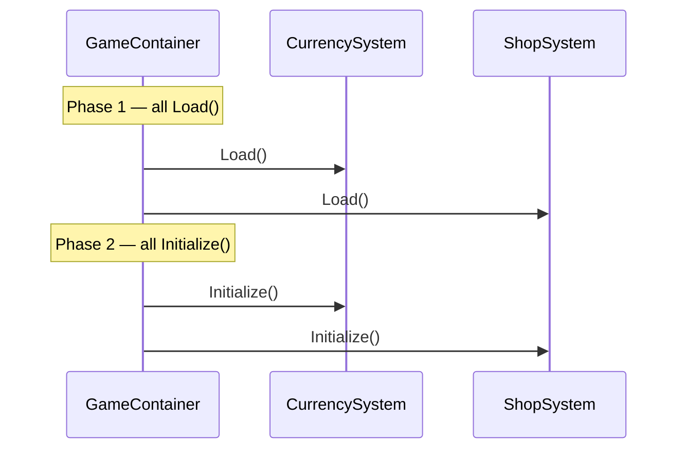

# Core Systems — lifecycle and data layers

How to design a **Core system**: when `Load` and `Initialize` run, how config / runtime / save relate, and how to persist changes.

**Container, DI, save orchestration:** [ARCHITECTURE.md](ARCHITECTURE.md)

---

## Table of contents

1. [Lifecycle](#lifecycle)
2. [Roles of each type](#roles-of-each-type)
3. [Collection-based system (Asset → Runtime → Save)](#collection-based-system-asset--runtime--save)
4. [Load](#load)
5. [Save](#save)
6. [Initialize and Dispose](#initialize-and-dispose)
7. [Mutations and OnSaveRequired](#mutations-and-onsaverequired)
8. [System without per-item objects](#system-without-per-item-objects)
9. [Consumers (other systems and UI)](#consumers-other-systems-and-ui)
10. [Installer binding order](#installer-binding-order)
11. [Checklist](#checklist)
12. [Anti-patterns](#anti-patterns)

---

## Lifecycle

On Core startup the root `GameContainer` runs (see [ARCHITECTURE.md](ARCHITECTURE.md#gamecontainerinitialize-pipeline)).

For **each** bound system:

```text
Constructor  →  ISavable.Load()  →  (later, all systems) IInitializable.Initialize()
```

**Important:** `Load()` runs for **all** savables first (`SaveLoadService.ExecuteLoads()`), then `Initialize()` runs for **all** `IInitializable` types. Order **between systems** in each phase = **bind order** in Core installers.



```csharp
// Core installer — bind order = Initialize order between systems
public override void Install(GameContainer container)
{
    container.BindInstance(_currencyConfig);
    container.Bind<CurrencySystem>();

    container.BindInstance(_shopConfig);
    container.Bind<ShopSystem>();
}
```

| Phase | Responsibility |
|-------|----------------|
| **Constructor** | Store injected config / services only |
| **`Load()`** | Read save file; build in-memory runtime state from **Config + Save** |
| **`Initialize()`** | Subscriptions, sync with other systems, derived state (optional) |
| **Runtime API** | Gameplay mutations → `OnSaveRequired` |
| **Session end** | `SaveLoadService.ExecuteSaves()` writes dirty savables |

---

## Roles of each type

### System (orchestrator)

Plain C# class in `Scripts/Core/...`. Bound with `container.Bind<MySystem>()`.

```csharp
public class CurrencySystem : ISavable, IInitializable
{
    private const string SAVE_KEY = "CurrencySave";

    public event Action OnSaveRequired;

    private readonly CurrencyConfig _config;
    private readonly Dictionary<string, CurrencyItemRuntime> _items = new();

    public CurrencySystem(CurrencyConfig config)
    {
        _config = config;
    }

    void ISavable.Load() { /* see Load section */ }
    void ISavable.Save() { /* see Save section */ }
    public void Initialize() { /* see Initialize section */ }
}
```

Implement `ISavable` for persistent systems. Add `IInitializable` when you need other systems after all `Load()` calls. Add `IDisposable` to unsubscribe.

### Config (static, ScriptableObject)

Designer data: item list, caps, tables. **Not written to player save.**

```csharp
[CreateAssetMenu(fileName = "Config_Currency", menuName = "Game/Configs/Currency")]
public class CurrencyConfig : BaseConfig
{
    [SerializeField] private List<CurrencyItemAsset> _assetCollection = new();

    public IReadOnlyList<CurrencyItemAsset> AssetCollection => _assetCollection;

    public CurrencyItemAsset GetItemAsset(string identifier) =>
        _assetByIdentifier.GetValueOrDefault(identifier);
}
```

Register before the system:

```csharp
container.BindInstance(_currencyConfig);
container.Bind<CurrencySystem>();
```

### System save (root DTO)

One serializable type per save file. **Primitives and nested DTOs only** — no `ScriptableObject` references.

```csharp
[Serializable]
public class CurrencySave
{
    public Dictionary<string, CurrencyItemSave> Items = new();
}
```

---

## Collection-based system (Asset → Runtime → Save)

Use when the system owns **many identifiable objects** (currencies, cards, inventory slots).

| Layer | Naming | Lifetime | Purpose |
|-------|--------|----------|---------|
| **Asset** | `*ItemAsset` | Project (SO) | Static definition: icon, id, rarity rules |
| **Runtime** | `*ItemRuntime` | Session (RAM) | Asset + mutable state (`AmountProperty`, etc.) |
| **Save** | `*ItemSave` | Disk (JSON) | Fields to restore next session |

```text
CurrencyConfig.AssetCollection     →  all CurrencyItemAsset (authoring)
              ↓ Load()
CurrencyItemRuntime per id         →  live state in CurrencySystem
              ↓ Save()
CurrencyItemSave in CurrencySave   →  persisted slice
```

### Item asset

```csharp
[CreateAssetMenu(fileName = "Currency_Gold", menuName = "Game/Items/Currency")]
public class CurrencyItemAsset : BaseItemAsset
{
    [SerializeField] private int _maxAmount = 999999;
    public int MaxAmount => _maxAmount;
}
```

`BaseItemAsset` provides `Identifier` (from `BaseIdentifierAsset` chain).

### Item runtime

```csharp
public class CurrencyItemRuntime
{
    public CurrencyItemAsset ItemAsset { get; }
    public AmountProperty Amount { get; }

    public CurrencyItemRuntime(CurrencyItemAsset itemAsset, int amount)
    {
        ItemAsset = itemAsset;
        Amount = new AmountProperty(itemAsset.Identifier, amount);
    }
}
```

Card-style systems add more properties on runtime:

```csharp
public class CardItemRuntime
{
    public CardItemAsset Asset { get; }
    public int Level { get; private set; }
    public UnlockProperty Unlock { get; }

    public CardItemRuntime(CardItemAsset asset, int level, UnlockState unlock)
    {
        Asset = asset;
        Level = level;
        Unlock = new UnlockProperty(asset.Identifier, unlock);
    }

    public void AddLevel(int value)
    {
        if (value > 0)
        {
            Level += value;
        }
    }
}
```

### Item save

```csharp
[Serializable]
public class CurrencyItemSave
{
    public int Amount;
}

[Serializable]
public class CardItemSave
{
    public int Level;
    public UnlockState UnlockState;
}
```

---

## Load

**Rule:** iterate **every** entry from **Config**, merge values from save if present, create **Runtime** for each id. New items added in a content patch appear with defaults.

```csharp
void ISavable.Load()
{
    var save = SaveLoadStorage.Load<CurrencySave>(SAVE_KEY);

    _items.Clear();

    foreach (var itemAsset in _config.AssetCollection)
    {
        var amount = 0;

        if (save.Items.TryGetValue(itemAsset.Identifier, out var itemSave))
            amount = itemSave.Amount;

        var runtime = new CurrencyItemRuntime(itemAsset, amount);
        _items.Add(itemAsset.Identifier, runtime);
    }
}
```

Card collection with unlock + level:

```csharp
void ISavable.Load()
{
    var save = SaveLoadStorage.Load<CardSave>(SAVE_KEY);

    foreach (var itemAsset in _cardConfig.AssetCollection)
    {
        var level = 0;
        var unlock = UnlockState.Locked;

        if (save.CardCollection.TryGetValue(itemAsset.Identifier, out var itemSave))
        {
            level = itemSave.Level;
            unlock = itemSave.UnlockState;
        }

        _cardCollection[itemAsset.Identifier] =
            new CardItemRuntime(itemAsset, level, unlock);
    }
}
```

**Do not** in `Load()`:

```csharp
// ✗ wrong
void ISavable.Load()
{
    _otherSystem.OnChanged += React;
    SceneLoadService.LoadGameplayScene();
}
```

---

## Save

Build a **new** DTO from runtime. Optionally skip “empty” rows to keep JSON small.

```csharp
void ISavable.Save()
{
    var save = new CurrencySave();

    foreach (var (id, runtime) in _items)
    {
        if (runtime.Amount.Value <= 0)
            continue;

        save.Items[id] = new CurrencyItemSave
        {
            Amount = runtime.Amount.Value
        };
    }

    SaveLoadStorage.Save(SAVE_KEY, save);
}
```

Card-style `shouldSave`:

```csharp
void ISavable.Save()
{
    var save = new CardSave();

    foreach (var (id, runtime) in _cardCollection)
    {
        var shouldSave = runtime.Level > 0
                         || runtime.Unlock.State != UnlockState.Locked;

        if (!shouldSave) continue;

        save.CardCollection[id] = new CardItemSave
        {
            Level = runtime.Level,
            UnlockState = runtime.Unlock.State
        };
    }

    SaveLoadStorage.Save(SAVE_KEY, save);
}
```

**Do not** call `SaveLoadStorage.Save` from public gameplay methods — use `OnSaveRequired` (see below).

---

## Initialize and Dispose

Use when the system needs **other systems** after every `Load()` has finished.

```csharp
public class SquadSelectionSystem : ISavable, IInitializable, IDisposable
{
    private readonly CardUnlocker _cardUnlocker;
    private readonly Dictionary<string, int> _selectedSlots = new();

    void ISavable.Load()
    {
        var save = SaveLoadStorage.Load<SquadSelectionSave>(SAVE_KEY);
        foreach (var (cardId, slot) in save.Selected)
            _selectedSlots[cardId] = slot;
    }

    public void Initialize()
    {
        foreach (var card in _cardUnlocker.GetUnlockedCollection())
            TryAutoSelect(card.ItemAsset.Identifier);

        _cardUnlocker.OnUnlockCompleted += TryAutoSelect;
    }

    public void Dispose()
    {
        _cardUnlocker.OnUnlockCompleted -= TryAutoSelect;
    }
}
```

`ISavable` **without** `IInitializable` is valid when nothing must run at boot:

```csharp
public class CurrencySystem : ISavable
{
    // Load + Save + public API only
}
```

---

## Mutations and OnSaveRequired

After any persisted change:

```csharp
public void AddCurrency(string identifier, int delta)
{
    if (!_items.TryGetValue(identifier, out var runtime))
        return;

    runtime.Amount.AddValue(delta);
    OnSaveRequired?.Invoke();
}

public void LevelUpCard(string identifier)
{
    var runtime = GetCardRuntime(identifier);
    runtime.AddLevel(1);
    OnSaveRequired?.Invoke();
}
```

Flow:

```text
Gameplay code → mutates Runtime → OnSaveRequired → (later) ExecuteSaves() → ISavable.Save() → SaveLoadStorage
```

---

## System without per-item objects

Some systems persist **structure only** (selection, cooldowns map, stage index) — no `*ItemAsset` / `*ItemRuntime`.

```csharp
public class CooldownSystem : ISavable, ITickable
{
    private const string SAVE_KEY = "CooldownSave";
    public event Action OnSaveRequired;

    private readonly Dictionary<string, DateTime> _endTimes = new();

    void ISavable.Load()
    {
        var save = SaveLoadStorage.Load<CooldownSave>(SAVE_KEY);
        foreach (var (key, ticks) in save.Entries)
            _endTimes[key] = new DateTime(ticks);
    }

    void ISavable.Save()
    {
        var save = new CooldownSave();
        foreach (var (key, end) in _endTimes)
            save.Entries[key] = end.Ticks;
        SaveLoadStorage.Save(SAVE_KEY, save);
    }
}
```

Same lifecycle: **`Load()` first**, then **`Initialize()`** if implemented.

---

## Consumers (other systems and UI)

### Another Core system (constructor)

```csharp
public class ShopSystem : IInitializable
{
    private readonly CurrencySystem _currency;

    public ShopSystem(CurrencySystem currency)
    {
        _currency = currency;
    }

    public void Initialize() { }

    public void Purchase(string currencyId, int cost)
    {
        _currency.AddCurrency(currencyId, -cost);
    }
}
```

### UI on content scene (`[Inject]`)

Read **Runtime**, never save DTOs:

```csharp
public class UICurrencyHud : MonoBehaviour, IInitializable
{
    private CurrencySystem _currency;

    [Inject]
    public void Inject(CurrencySystem currency) => _currency = currency;

    public void Initialize()
    {
        foreach (var runtime in _currency.GetAllRuntimes())
            CreateRow(runtime.ItemAsset.Identifier, runtime.Amount.Value);
    }
}
```

---

## Installer binding order

```csharp
container.BindInstance(_cardConfig);
container.BindInstance(_currencyConfig);

container.Bind<CardSystem>();
container.Bind<CardUnlocker>();

container.Bind<SquadSelectionSystem>();

container.Bind<CoreBootstrapEntry>();
```

If `SquadSelectionSystem.Initialize()` uses `CardUnlocker`, `CardUnlocker` must be **bound before** `SquadSelectionSystem`.

---

## Checklist

- [ ] `{Name}System` implements `ISavable`; `IInitializable` only if needed
- [ ] `{Name}Config` + `BindInstance` before `Bind<{Name}System>`
- [ ] `{Name}Save` + per-item `{Name}ItemSave` if collection-based
- [ ] `Load`: loop **config** collection, merge save, build runtime dictionary
- [ ] `Save`: runtime → DTO; skip empty rows if desired
- [ ] Public mutators call `OnSaveRequired?.Invoke()`
- [ ] No file I/O or cross-system subscribe in `Load()`
- [ ] Bind order matches Initialize dependencies

---

## Anti-patterns

```csharp
// ✗ Save DTO exposed to UI
uiLabel.text = save.Items["gold"].Amount.ToString();

// ✓ Runtime API
uiLabel.text = _currency.GetRuntime("gold").Amount.Value.ToString();
```

```csharp
// ✗ Reload on content scene
public void Initialize() => SaveLoadStorage.Load<CurrencySave>(...);

// ✓ Loaded once at Core; inject CurrencySystem
```

```csharp
// ✗ Direct save on every click
SaveLoadStorage.Save(SAVE_KEY, dto);

// ✓ OnSaveRequired after mutation
OnSaveRequired?.Invoke();
```

```csharp
// ✗ Iterate save keys as source of truth in Load
foreach (var (id, itemSave) in save.Items) { ... }

// ✓ Iterate config assets; save only overrides values
foreach (var asset in _config.AssetCollection) { ... }
```
